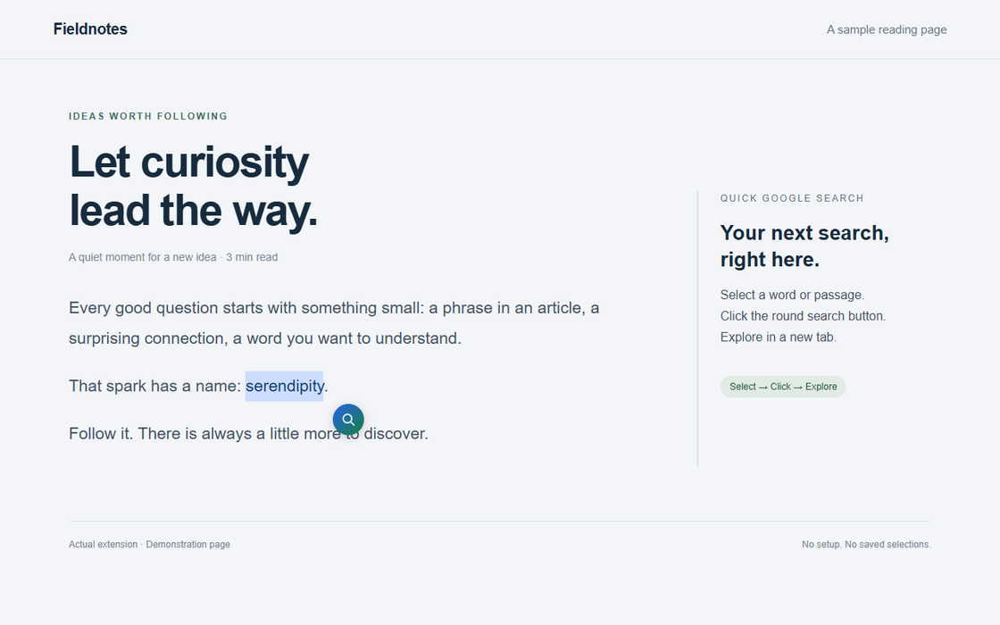

<p align="center"></p>

<h1 align="center">Quick Google Search</h1>

<p align="center">気になった言葉から、次の発見へ。</p>
<p align="center">選択したテキストのそばに、Google検索のショートカットを。</p>

<p align="center">
  
  <a href="LICENSE"></a>
  
</p>

<p align="center"><a href="README.md">English</a> · 日本語</p>



## 読む流れのまま、検索へ

Webページでテキストを選択し、丸い検索ボタンをクリック。新しいタブでGoogle検索が開き、読んでいたページはそのまま。初期設定もアカウントも不要です。

- **機能はひとつ。** 選択して、クリックして、Google検索。
- **キーボードでも。** キーボードで選択後、Tabでボタンに移動し、EnterまたはSpaceで検索。Escapeで閉じられます。
- **ページになじむ。** 画面端で位置を調整し、サイト側のCSSからボタンの見た目を隔離しています。
- **余計な通信なし。** 広告、解析、バックグラウンド送信、選択テキストの保存はありません。
- **日本語・英語対応。** ボタンの表示言語はChromeの設定に従います。

## インストール

現在、Chrome ウェブストアには掲載していません。ローカルにインストールできます。

1. [ソースZIPをダウンロード](https://github.com/Kaito-Rowing/quick-google-search/archive/refs/heads/main.zip)して展開するか、このリポジトリをcloneします。
2. Chromeで `chrome://extensions` を開きます。
3. **デベロッパー モード**を有効にします。
4. **パッケージ化されていない拡張機能を読み込む**を選び、`manifest.json` が入っているフォルダを指定します。
5. すでに開いていたWebページを再読み込みします。

配布用ZIPを受け取った場合も、展開したフォルダを手順4で選びます。インストール中はそのフォルダを移動・削除しないでください。

## 使い方

1. Webページの単語や文章を選択します。
2. 選択箇所のそばに出る検索ボタンをクリックします。
3. 新しいタブでGoogleの検索結果を確認します。

選択解除、Escape、スクロール、ウィンドウのリサイズ、タブを離れる操作でボタンが消えます。選択しただけで検索が始まることはありません。

### 対応範囲

HTTP・HTTPSページのメインフレームが対象です。Chromeの内部ページ、Chrome ウェブストア、内蔵PDFビューア、ローカルファイルには対応していません。フレーム内や閉じたShadow DOM内のテキストも対象外です。独自の選択処理や特殊なレイアウトを持つサイトでは、正しく表示されない場合があります。

パスワード欄、入力欄、テキストエリア、リッチテキストエディタなどの編集領域では、意図しない送信を避けるためボタンを表示しません。長すぎる選択はブラウザやGoogleのURL制限にかかる場合があるので、短い範囲で検索してください。

## プライバシーとページへのアクセス

追加のAPI権限は要求しません。ただし、選択の検出とボタンの表示のため、コンテンツスクリプトが**HTTP・HTTPSページにアクセスします**。Chromeでは「サイトのデータの読み取りと変更」などと表示されることがあります。アクセス先はChromeの拡張機能設定で制限できます。

選択テキストは一時的にメモリで扱い、ボタンを閉じると破棄します。ストレージへの保存やバックグラウンド送信はしません。検索操作をしたときだけ、Googleの検索URLに選択テキストを含めて新しいタブを開きます。このURLはブラウザやGoogleの設定・ポリシーに従って履歴などに残る可能性があります。新しいタブには `noopener,noreferrer` を指定しています。

詳しくは[プライバシーポリシー](docs/PRIVACY.ja.md)をご覧ください。Googleとは関係のない独立したプロジェクトです。

## 開発

拡張機能自体にビルド処理や実行時の依存パッケージはありません。開発・検証・配布用ZIPの作成にはNode.js 24とnpmを使います。

```sh
npm ci
npx playwright install chromium
npm run check
npm test
npm run package
```

自動テストでは、実際に拡張機能を読み込んだChromiumで検索、選択変更、キーボード操作、CSS干渉、画面端の表示を確認します。配布用ZIPは `dist/quick-google-search-1.0.1.zip` に生成されます。CIでも同じ検証を実行し、ZIPを成果物として保存します。

編集後は `chrome://extensions` で拡張機能を再読み込みし、テスト対象ページも更新してください。手動確認は [CONTRIBUTING.md](CONTRIBUTING.md)、公開準備は[リリースガイド](docs/RELEASING.md)にまとめています。

## フィードバック

不具合は[Issue](https://github.com/Kaito-Rowing/quick-google-search/issues/new/choose)へ。Chromeのバージョン、公開できるURL、再現手順があると調査しやすくなります。非公開の文章や個人情報は載せないでください。

## ライセンス

[MIT](LICENSE) © 2026 Kaito-Rowing
