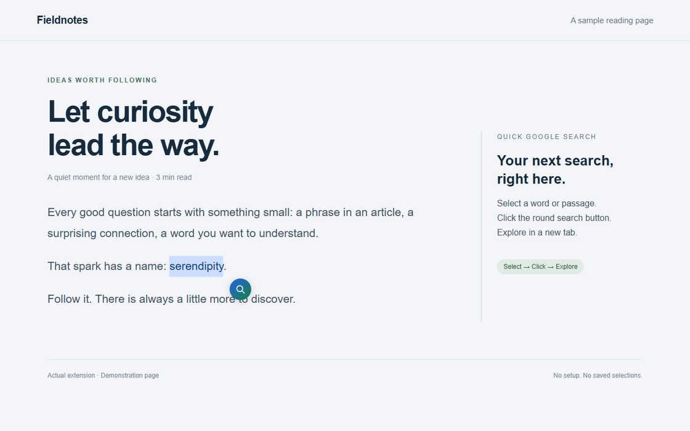

<p align="center"></p>

<h1 align="center">Quick Google Search</h1>

<p align="center">Select a thought. Keep exploring.</p>
<p align="center">A tiny Chrome extension that puts Google Search next to the text you select.</p>

<p align="center">
  
  <a href="LICENSE"></a>
  
</p>

<p align="center">English · <a href="README.ja.md">日本語</a></p>



## A shorter path from reading to searching

Select text on a web page and click the round search button. Google opens in a new tab; your reading stays where it was. No setup, account or search history inside the extension.

- **One purpose.** A selection, a button, a Google search.
- **Keyboard friendly.** Select with the keyboard, Tab to the button, and press Enter or Space. Escape dismisses it.
- **Fits the page.** The button stays within the viewport and its styles are isolated from the site.
- **Quiet by default.** No analytics, ads, background requests or stored selections.
- **English and Japanese.** The search button follows Chrome's language.

## Install

There is currently no Chrome Web Store listing. Install locally:

1. [Download the source ZIP](https://github.com/Kaito-Rowing/quick-google-search/archive/refs/heads/main.zip) and extract it, or clone this repository.
2. Open `chrome://extensions` in Chrome.
3. Turn on **Developer mode**.
4. Choose **Load unpacked** and select the folder containing `manifest.json`.
5. Refresh any web pages that were already open.

If you receive a packaged release ZIP, extract it and select that extracted folder in step 4. Keep the folder in place while the extension is installed.

## Use

1. Select a word or passage on a regular web page.
2. Click the search button beside your selection.
3. Continue in the new Google Search tab.

The button disappears when you clear the selection, press Escape, scroll, resize or leave the tab. Selecting text never starts a search by itself.

### Where it works

The extension runs on HTTP and HTTPS pages in the main frame. Chrome internal pages, the Chrome Web Store, built-in PDF viewer and local files are not supported. Text inside frames or closed shadow trees is not supported. Some sites with custom selection handling or unusual layouts may prevent the button from appearing correctly.

Form fields and editable regions are intentionally excluded, including passwords, text inputs, textareas and rich-text editors. Very long passages may exceed the browser or Google's URL limits; search shorter selections in that case.

## Privacy & page access

The extension requests no additional API permissions. It **does have access to HTTP and HTTPS pages** through its declared content script; Chrome may describe this as access to read and change site data. That access is used to detect selections and insert the button. You can restrict site access in Chrome's extension settings.

Selected text is held temporarily in memory and cleared when the button is hidden. The extension does not write it to storage or send it in the background. Only an explicit search sends the selection to `https://www.google.com/search` as a URL query. Google and your browser may retain that URL under their own settings and policies. The new tab uses `noopener,noreferrer`.

Read the [privacy policy](PRIVACY.md) for details. Quick Google Search is an independent project, not affiliated with Google.

## Development

The extension runs directly from source, with **no build step or runtime dependencies**. Node.js 24 and npm are needed only for development checks and packaging.

```sh
npm ci
npx playwright install chromium
npm run check
npm test
npm run package
```

`npm test` loads the actual extension in Playwright's Chromium and checks search navigation, selection handling, keyboard controls, page-style isolation and viewport bounds. `npm run package` produces `dist/quick-google-search-1.0.1.zip` with an explicit runtime-file allowlist. CI runs the same checks and uploads the ZIP as a workflow artifact.

After editing, reload the extension at `chrome://extensions` and refresh your test page. See [CONTRIBUTING.md](CONTRIBUTING.md) for the manual checks and [the release guide](docs/RELEASING.md) for publishing steps.

## Feedback

Found a page where selection behaves strangely? [Open an issue](https://github.com/Kaito-Rowing/quick-google-search/issues/new/choose) with your Chrome version, a public example URL and steps to reproduce. Please leave private page content out of reports.

## License

[MIT](LICENSE) © 2026 Kaito-Rowing
